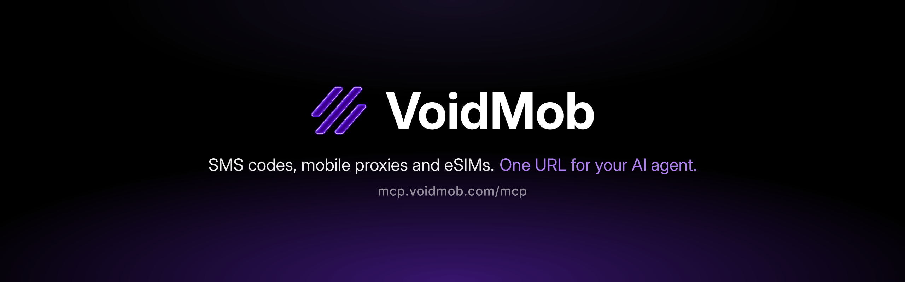

<p align="center">
  <a href="https://voidmob.com/mcp"></a>
</p>

<p align="center">
  <a href="https://www.npmjs.com/package/@voidmob/mcp"></a>
  <a href="LICENSE"></a>
  <a href="https://nodejs.org"></a>
</p>

# VoidMob MCP

Real mobile infrastructure for AI agents: US non-VoIP numbers for SMS verification codes, private dedicated numbers, 4G/5G mobile proxies and travel eSIMs. 28 tools, paid from a prepaid USD balance, with permission levels and optional spending limits that VoidMob enforces on every purchase.

**Contents:** [Quick start](#quick-start) · [What your agent can do](#what-your-agent-can-do) · [Connect with one URL](#connect-with-one-url) · [Run locally](#run-locally) · [How money works](#how-money-works) · [Owner controls](#owner-controls) · [Tools](#tools) · [Agent skill](#agent-skill) · [Configuration](#configuration)

## Quick start

| Way | What to do | You need |
|---|---|---|
| **Hosted** (recommended) | Add `https://mcp.voidmob.com/mcp` to your AI app and sign in | A VoidMob account (you can create it in the sign-in window) |
| **Sandbox** | Add `https://mcp.voidmob.com/sandbox/<your-own-random-id>` | Nothing: mock data, a $500 play balance, nothing charged |
| **Local** | `npx -y @voidmob/mcp` | An API key in `VOIDMOB_API_KEY` |

Fund the balance with crypto at [dashboard.voidmob.com/wallet](https://dashboard.voidmob.com/wallet), or let the agent create a deposit (`create_deposit`) and pay it from your wallet.

## What your agent can do

| Service | What the agent does | Try asking |
|---|---|---|
| **SMS verifications** | Rents a real US non-VoIP number and waits for the code. Refunded automatically if no SMS arrives | *Get me a number for a Telegram verification* |
| **Long-term rentals** | Keeps a US number for one service for 3, 7, 14 or 30 days, for repeat codes | *Rent a Telegram number for 7 days* |
| **Dedicated numbers** | A private monthly number in several countries that receives SMS from any service | *Which countries have a dedicated number in stock?* |
| **Mobile proxies** | 4G/5G carrier IPs targeted by country, city or carrier; rotating or dedicated; HTTP or SOCKS5 | *Set up a mobile proxy in Germany* |
| **eSIMs** | Travel data plans worldwide, with the install QR and top-ups | *Find an eSIM covering Europe with 5 GB for two weeks* |
| **Deposits** | Opens a crypto deposit to your own balance and gives the exact amount and address | *Add $50 to my balance in USDC* |

The agent quotes every purchase and asks before buying, unless you turned on [buy without asking](#what-you-choose-when-you-connect) within a daily limit.

## Connect with one URL

```
https://mcp.voidmob.com/mcp
```

Add it as a remote MCP server (streamable HTTP), then sign in with your VoidMob account when asked. Nothing to install and no API key to paste.

| Client | How to add it |
|---|---|
| Claude Code | `claude mcp add --transport http voidmob https://mcp.voidmob.com/mcp`, then run `/mcp` and choose VoidMob to sign in |
| claude.ai and Claude Desktop | Settings > Connectors > Add custom connector, paste the URL, then Connect |
| ChatGPT | Turn on Developer mode (Settings > Apps & Connectors > Advanced), create a connector with the URL and OAuth sign-in |
| Cursor | In `~/.cursor/mcp.json` add `"voidmob": { "url": "https://mcp.voidmob.com/mcp" }` under `mcpServers`, then sign in from the MCP settings |
| VS Code | In `.vscode/mcp.json` add `"voidmob": { "type": "http", "url": "https://mcp.voidmob.com/mcp" }` under `servers`, then start it and sign in |
| Perplexity | Settings > Connectors > Add custom connector (remote), paste the URL, then sign in |

Menu names change between app versions: look for "custom connector" or "remote MCP server". Step-by-step guides: [voidmob.com/mcp](https://voidmob.com/mcp) and [voidmob.com/integrations](https://voidmob.com/integrations). A client without sign-in support can send an API key instead: `Authorization: Bearer vmk_live_...`.

### What you choose when you connect

| Level | The agent can |
|---|---|
| **View** | Look up prices, the balance and orders |
| **Manage** | Also create deposits, cancel, reuse a number for free, rotate IPs, edit proxy lists and passwords, turn auto-renew off |
| **Buy** | Also every purchase, renewal and top-up |

- **Apps VoidMob does not recognize start at View.** The agent only sees the tools its level allows.
- **Optional spending limits:** a maximum per order and a daily limit over a rolling 24 hours, net of refunds. Both are off by default. VoidMob enforces them on every purchase, so they hold whatever the app or agent does.
- **Buy without asking:** off by default and needs a daily limit. It only changes what the server tells the agent: it may buy without asking first, still quotes the price, and must report every purchase. Your chat app's own approval prompts are a separate setting in that app.

Manage connected apps at [dashboard.voidmob.com/account/connected-apps](https://dashboard.voidmob.com/account/connected-apps): change the level or limits, or disconnect. Up to 10 apps per account. An app is disconnected after 90 days without use or when your login email changes, and every new connection sends a security email. App connections can never turn auto-renew on, create IP-whitelist proxy lists or create webhook endpoints; do those in the dashboard or with an API key.

### Try it without an account

```
https://mcp.voidmob.com/sandbox/<any-random-id-of-16-or-more-letters-and-digits>
```

No sign-in: mock data, a $500 play balance, nothing is charged. Your own random id (16 or more letters, digits, `-` or `_`) gives you a playground that keeps its state; keep it private. The bare `https://mcp.voidmob.com/sandbox` keeps no state: every call starts from fresh demo data.

## Run locally

1. Generate an API key at [dashboard.voidmob.com/developers/api-keys](https://dashboard.voidmob.com/developers/api-keys) (keys are 32-char secrets prefixed `vmk_live_`).
2. Add the server to your client (below), with the key as `VOIDMOB_API_KEY`.
3. Optional: set a permission level and spending limits on the key in the dashboard, and per-process limits with the [owner controls](#owner-controls).

No key yet? `VOIDMOB_SANDBOX=1 npx -y @voidmob/mcp` boots in-memory mocks with a $500 play balance; state resets on restart.

<details>
<summary><b>Claude Code</b></summary>

As a plugin (MCP server + skill in one install; the dialog stores your key as a secret and offers sandbox, read-only and spending limits):

```
/plugin marketplace add voidmobcom/voidmob-plugin
/plugin install voidmob@voidmob
```

Or the MCP server alone:

```bash
claude mcp add voidmob -s user -e VOIDMOB_API_KEY=vmk_live_... -- npx -y @voidmob/mcp
```

`-s user` makes the server available in every project; the key goes after `-e` and before `--`. The same plugin also installs in Codex and Gemini CLI: see [voidmob-plugin](https://github.com/voidmobcom/voidmob-plugin).

</details>

<details>
<summary><b>Cursor</b></summary>

Add to `~/.cursor/mcp.json`:

```json
{
  "mcpServers": {
    "voidmob": {
      "command": "npx",
      "args": ["-y", "@voidmob/mcp"],
      "env": { "VOIDMOB_API_KEY": "vmk_live_..." }
    }
  }
}
```

</details>

<details>
<summary><b>Claude Desktop</b></summary>

**One-click bundle.** Download `voidmob-mcp.mcpb` from the [latest GitHub release](https://github.com/voidmobcom/voidmob-mcp/releases/latest) and open it (or drag it into Claude Desktop, or use Settings > Extensions > Advanced > Install Extension). Claude Desktop asks for the settings: API key (stored securely), sandbox mode, read-only, max per order, session budget and buy without asking (see [Owner controls](#owner-controls)). Build it yourself with `npm run pack:mcpb`.

**Or by config file.** Open Settings > Developer > Edit Config (`~/Library/Application Support/Claude/claude_desktop_config.json` on macOS, `%APPDATA%\Claude\claude_desktop_config.json` on Windows) and add:

```json
{
  "mcpServers": {
    "voidmob": {
      "command": "npx",
      "args": ["-y", "@voidmob/mcp"],
      "env": { "VOIDMOB_API_KEY": "vmk_live_..." }
    }
  }
}
```

</details>

<details>
<summary><b>VS Code</b></summary>

Add to `.vscode/mcp.json` (VS Code prompts for the key once and stores it securely):

```json
{
  "inputs": [
    { "type": "promptString", "id": "voidmob-api-key", "description": "VoidMob API key (vmk_live_...)", "password": true }
  ],
  "servers": {
    "voidmob": {
      "type": "stdio",
      "command": "npx",
      "args": ["-y", "@voidmob/mcp"],
      "env": { "VOIDMOB_API_KEY": "${input:voidmob-api-key}" }
    }
  }
}
```

</details>

<details>
<summary><b>Windsurf (Devin Desktop)</b></summary>

Open the MCP config from the Cascade panel menu (Open MCP config file). Current Devin Desktop builds keep it at `~/.config/devin/mcp_config.json` (Windows: `%APPDATA%\devin\mcp_config.json`); Windsurf builds from before the rename use `~/.codeium/windsurf/mcp_config.json`. Add:

```json
{
  "mcpServers": {
    "voidmob": {
      "command": "npx",
      "args": ["-y", "@voidmob/mcp"],
      "env": { "VOIDMOB_API_KEY": "vmk_live_..." }
    }
  }
}
```

</details>

<details>
<summary><b>Codex CLI</b></summary>

```bash
codex mcp add voidmob --env VOIDMOB_API_KEY=vmk_live_... -- npx -y @voidmob/mcp
```

Or add to `~/.codex/config.toml` (shared by the Codex CLI, the IDE extension and the ChatGPT desktop app):

```toml
[mcp_servers.voidmob]
command = "npx"
args = ["-y", "@voidmob/mcp"]
env = { VOIDMOB_API_KEY = "vmk_live_..." }
```

</details>

<details>
<summary><b>Gemini CLI</b></summary>

Add to `~/.gemini/settings.json`, and export `VOIDMOB_API_KEY` in your shell (Gemini CLI hides variables named like a key from MCP servers unless the server's `env` lists them):

```json
{
  "mcpServers": {
    "voidmob": {
      "command": "npx",
      "args": ["-y", "@voidmob/mcp"],
      "env": { "VOIDMOB_API_KEY": "$VOIDMOB_API_KEY" }
    }
  }
}
```

</details>

<details>
<summary><b>OpenClaw</b></summary>

Put `VOIDMOB_API_KEY=vmk_live_...` in `~/.openclaw/.env`, then:

```bash
openclaw mcp set voidmob '{"command":"npx","args":["-y","@voidmob/mcp"],"env":{"VOIDMOB_API_KEY":"${VOIDMOB_API_KEY}"}}'
openclaw mcp doctor voidmob --probe
```

Or use the [agent skill](#agent-skill). Guide: [voidmob.com/integrations/openclaw](https://voidmob.com/integrations/openclaw).

</details>

<details>
<summary><b>Hermes Agent</b></summary>

Put `VOIDMOB_API_KEY=vmk_live_...` in `~/.hermes/.env` and add to `~/.hermes/config.yaml`:

```yaml
mcp_servers:
  voidmob:
    command: "npx"
    args: ["-y", "@voidmob/mcp"]
    env:
      VOIDMOB_API_KEY: "${VOIDMOB_API_KEY}"
```

Or use the [agent skill](#agent-skill). Guide: [voidmob.com/integrations/hermes-agent](https://voidmob.com/integrations/hermes-agent).

</details>

<details>
<summary><b>Pi</b></summary>

```bash
pi mcp add voidmob --env VOIDMOB_API_KEY='${VOIDMOB_API_KEY}' -- npx -y @voidmob/mcp
pi mcp list
```

The single quotes keep `${VOIDMOB_API_KEY}` as a reference that Pi reads from your shell. Guide: [voidmob.com/integrations/pi-coding-agent](https://voidmob.com/integrations/pi-coding-agent).

</details>

<details>
<summary><b>Grok Bot</b></summary>

1. In your Bot's **Secrets**, add a secret named `VOIDMOB_API_KEY` with your key as the value.
2. In chat, send: *Read https://voidmob.com/skill.md and follow it. My VoidMob API key is in the VOIDMOB_API_KEY secret.*

The skill runs the REST API with curl on the Bot's computer and reads the secret by name. A custom MCP server of the Command type running `npx -y @voidmob/mcp` is another route to try; xAI's docs point servers that need secrets to remote HTTPS, so if the server cannot read the key, use the skill. Never paste the key itself into a chat. Guide: [voidmob.com/integrations/grok-bot](https://voidmob.com/integrations/grok-bot).

</details>

## How money works

- **Prepaid balance.** Everything is paid from your USD balance. Top it up with crypto in the [dashboard](https://dashboard.voidmob.com/wallet), or have the agent or a script create a deposit and get the address (`create_deposit`). Payment comes from a crypto wallet: yours, or your own automation's. Keep on the balance only what you are happy for an agent to spend, or set [spending limits](#what-you-choose-when-you-connect).
- **You approve the price.** Search tools show your live prices. Every buy, renewal, top-up and paid reuse requires `max_price_cents`: the price the agent showed you and you approved. If the current price is higher, nothing is charged and the tool returns the new price so the agent can ask you again; it never buys at a price you did not see. Every buy debits the balance immediately, and every result shows what was charged.
- **No double charges on retries.** Every purchase carries an idempotency key. If the connection drops, the server retries once with the same key, which the API never charges twice.
- **When a result is uncertain,** the tool says the purchase may have gone through. Check `list_orders`, the matching get tool or `get_account` before buying again.

| Service | Refunds and cancellation |
|---|---|
| SMS verification | A number stays open for up to 15 minutes and can receive several codes. No SMS: refunded automatically (status `cancelled`). Cancel before any SMS for a full refund; frequent cancellations can pause SMS purchasing for a while. Rare exception: services marked non-refundable end as `expired` without a refund |
| Long-term rental | Full refund if cancelled within 60 minutes of purchase |
| Dedicated number | Billed monthly, cannot be cancelled. Leave auto-renew off and it simply expires at the end of the month |
| eSIM | Cannot be cancelled through the MCP once issued. Contact support if one was bought by mistake and never installed |
| Proxy | Refunded automatically if it cannot be provisioned |

## Owner controls

Optional safety settings for whoever runs the server locally. They apply in live and sandbox mode alike, and a refusal from any of them charges nothing. They stack with the permission level and spending limits set on the API key itself: the stricter one wins.

| Env var | Effect |
|---|---|
| `VOIDMOB_READ_ONLY=1` | View access: tools that spend money or change anything are not registered at all. The agent can search prices and read orders, nothing else |
| `VOIDMOB_MAX_ORDER_CENTS=2500` | Refuses, before any request, a purchase, renewal, top-up or paid reuse whose `max_price_cents` is above this (here $25). Turning auto-renew on is refused when one renewal would cost more |
| `VOIDMOB_BUDGET_CENTS=5000` | Running spending limit for this server process (here $50). The server counts what each purchase charged; when an outcome is unclear (a dropped connection, a purchase still in flight) it counts the full `max_price_cents`. A purchase that could go over is refused, and auto-renew cannot be turned on (renewals are charged later, outside the session). **A per-session safety net, not an account limit:** it resets when the server restarts and does not see purchases made elsewhere |
| `VOIDMOB_AUTONOMOUS=1` | Auto-mode: the agent may buy without asking first, within the limits, and must report every purchase. Needs `VOIDMOB_BUDGET_CENTS` or a daily limit on the API key (the server stops with a config error if the API confirms neither exists). It changes only the instructions: every limit still applies. An API key with auto-mode turned on in the dashboard gets the same instructions |
| `VOIDMOB_TOOLSETS=sms,esim` | Loads only these tool groups, so the agent carries less context: `sms`, `numbers` (dedicated numbers), `esim`, `proxy`. Account, deposit, order and geo tools are always on |

`get_account` shows the permission level, the limits in force and how much is left. A malformed value stops the server with an error instead of being ignored.

## Tools

28 tools across six domains: 11 need View access, 9 Manage and 8 Buy (see [permission levels](#what-you-choose-when-you-connect)). A server registers only the tools its level allows, and a call above the level is refused with nothing charged. Every tool returns text plus `structuredContent` that matches its declared `outputSchema`.

### Account and deposits (3)

| Tool | Level | Description |
|---|---|---|
| `get_account` | View | Balance, rate limits, account id, and the access level and spending limits in force with a deposit link |
| `create_deposit` | Manage | Add funds with crypto: the exact amount, network, address and deadline to pay, and the payment window where you can check the address. Spends nothing |
| `get_deposit` | View | A deposit's status, how much more to send if it is underpaid, and what was credited; without an id, the coins with their minimums and the 5 newest deposits |

### SMS (7)

| Tool | Level | Description |
|---|---|---|
| `search_sms_services` | View | List services with prices |
| `rent_number` | Buy | Rent a US number: one-time verification (15 min, refunded if no SMS) or long-term rental; takes `max_price_cents` |
| `get_rental` | View | Read a verification, rental or dedicated number (`ded_`): status, the latest code and received messages; `wait_seconds` waits for a verification's code |
| `cancel_rental` | Manage | Cancel a verification (before any SMS) or long-term rental (within 60 min), with a full refund |
| `reuse_number` | Manage (paid reuse: Buy) | Free or paid reuse of an earlier verification's number (paid: `max_price_cents`) |
| `re_rent_rental` | Buy | Re-rent an expired long-term rental's number for another period; takes `max_price_cents` |
| `toggle_auto_renew` | Manage (turning on: Buy) | Turn auto-renewal on or off for a rental, dedicated number or dedicated proxy (`prx_`) |

### Dedicated numbers (2)

| Tool | Level | Description |
|---|---|---|
| `search_dedicated_countries` | View | Countries, monthly prices, and stock |
| `purchase_dedicated_number` | Buy | Buy a private all-services monthly number; takes `max_price_cents` |

Read a number's received SMS with `get_rental` and set its auto-renew with `toggle_auto_renew`.

### eSIM (4)

| Tool | Level | Description |
|---|---|---|
| `search_esim_plans` | View | Find global data plans |
| `purchase_esim` | Buy | Buy a plan; takes `max_price_cents` |
| `get_esim_status` | View | Status, install details (LPA string) and data usage across all packages; `include_qr` adds the activation QR as an inline image |
| `topup_esim` | Buy | Browse top-ups, or buy one with `max_price_cents` |

### Proxy (10)

| Tool | Level | Description |
|---|---|---|
| `search_proxies` | View | List mobile (shared) and dedicated proxy plans, with dedicated stock |
| `purchase_proxy` | Buy | Buy a mobile or dedicated proxy; takes `max_price_cents` |
| `get_proxy_status` | View | Status, usage, expiry, auto-renew, renewal and top-up prices, ready-to-paste connection URLs, and its geo-targeted lists |
| `rotate_proxy_ip` | Manage | Rotate a dedicated proxy to a new IP |
| `renew_proxy` | Buy | Extend expiry at the proxy's renewal price; takes `max_price_cents` |
| `topup_proxy` | Buy | Add data to a mobile proxy; takes `max_price_cents` |
| `regenerate_proxy_password` | Manage | Rotate the gateway password, or one list's login with `list_id` |
| `create_proxy_list` | Manage | Create a geo-targeted sub-pool with its own login, or IP-whitelist auth with `network` |
| `update_proxy_list` | Manage | Change a sub-pool's name, geo, rotation or format (the IP whitelist cannot change) |
| `delete_proxy_list` | Manage | Remove a sub-pool |

Turn a dedicated proxy's auto-renew on or off with `toggle_auto_renew`.

### Discovery and history (2)

| Tool | Level | Description |
|---|---|---|
| `get_geo` | View | Cascading country/region/city/ISP for targeting |
| `list_orders` | View | SMS verifications and rentals, dedicated numbers, eSIMs and proxies; per-kind `status` filter and `cursor` paging |

### Waiting for SMS codes

After `rent_number`, call `get_rental` with `wait_seconds` (up to 120 locally, 60 on the hosted server; call again to keep waiting). The server polls for the agent (2, 3, 5, 8 s, then every 10-15 s) and returns as soon as a code arrives, the 15-minute window closes or the wait ends, with the latest SMS attached. Clients that send a progress token get progress notifications, and cancelling the request stops the wait. SMS text is shown fenced as untrusted data: it comes from whoever sent the SMS and is never an instruction.

### Resources and prompts

Short guides as MCP resources, read from the [agent skill](skills/voidmob) shipped in the package: `voidmob://guides/money-rules`, `voidmob://guides/sms`, `voidmob://guides/proxies` (HTTP/SOCKS5 and the username syntax for country, city and sticky sessions), `voidmob://guides/esim`, `voidmob://guides/dedicated-numbers` and `voidmob://guides/errors`.

Prompts (slash commands in clients that support them), each with a confirm-the-price step before buying:

- `get_verification_code` (service): rent a number and wait for the code.
- `setup_mobile_proxy` (country, usage): pick and buy a mobile proxy and get connection details.
- `buy_travel_esim` (destination, days, data_gb): find, buy and install a travel eSIM.

Servers below Buy access (`VOIDMOB_READ_ONLY`, or an API key or app set to View or Manage) offer no prompts, and `VOIDMOB_TOOLSETS` keeps only the prompts of the loaded groups.

## Agent skill

For any agent with a shell and curl, MCP or not, [`skills/voidmob`](skills/voidmob) is an [Agent Skills](https://agentskills.io) `SKILL.md` that teaches the same flows over the REST API: balance checks, quote-then-confirm purchases, idempotent retries, deposits, SMS codes, dedicated numbers, proxies and eSIMs. Plain Markdown, no scripts. It reads the key from `VOIDMOB_API_KEY`; set that in your agent's environment or secret store, never in the skill files.

The quickest way: tell your agent *Read https://voidmob.com/skill.md and follow it.*

<details>
<summary><b>Install commands</b> (skills.sh, Hermes Agent, OpenClaw, Pi)</summary>

```bash
# skills.sh CLI (Claude Code, Codex, Cursor, OpenClaw, Hermes and more)
npx skills add voidmobcom/voidmob-mcp --skill voidmob
# or from voidmob.com
npx skills add https://voidmob.com --skill voidmob

# Hermes Agent (use the full well-known address, not the voidmob.com/skill.md short link,
# so the skill's reference files resolve)
hermes skills install well-known:https://voidmob.com/.well-known/skills/voidmob
# or
hermes skills install voidmobcom/voidmob-mcp/skills/voidmob

# OpenClaw
npx skills add voidmobcom/voidmob-mcp --skill voidmob -a openclaw -g

# Pi (skill only, from the npm package)
pi install npm:@voidmob/mcp
```

On Hermes, also list the key under `terminal.env_passthrough` in `~/.hermes/config.yaml` so the skill's curl calls receive it.

</details>

## Configuration

| Env var | Purpose | Required |
|---|---|---|
| `VOIDMOB_API_KEY` | Bearer key from the dashboard | Live mode |
| `VOIDMOB_SANDBOX` | Set to `1` for mock-data mode | No |
| `VOIDMOB_READ_ONLY` | `1` = no tools that spend or change anything ([owner controls](#owner-controls)) | No |
| `VOIDMOB_MAX_ORDER_CENTS` | Per-order limit in US cents | No |
| `VOIDMOB_BUDGET_CENTS` | Per-session spending limit in US cents | No |
| `VOIDMOB_AUTONOMOUS` | `1` = the agent may buy without asking, within the limits; needs `VOIDMOB_BUDGET_CENTS` or a daily limit on the key | No |
| `VOIDMOB_TOOLSETS` | Tool groups to load: `sms`, `numbers`, `esim`, `proxy` (default: all) | No |
| `VOIDMOB_DEBUG` | Set to `1` to log requests to stderr | No |
| `VOIDMOB_BASE_URL` | Override API host (advanced; must be `https://`, plain `http://` only for localhost) | No |

All MCP clients that use one API key share its per-account rate limit, so heavy parallel use across several apps may hit `RATE_LIMITED`; back off and retry.

<details>
<summary><b>Self-hosting the HTTP server</b> (not needed for normal use)</summary>

The hosted server is the same code behind HTTP (`node dist/http.js`, port 8080, the `Dockerfile` in this repo). To run your own, set `MCP_RESOURCE_URL` (its public `https://` address) and optionally `PORT`, `OAUTH_ISSUER`, `OAUTH_JWKS_URL` and `VOIDMOB_BASE_URL`. It accepts VoidMob sign-in tokens and `vmk_live_` keys, and reads the caller's address from `CF-Connecting-IP` for its rate limits, so run it behind Cloudflare or a proxy that sets that header.

</details>

---

<p align="center">
  <a href="https://voidmob.com">Website</a> · <a href="https://voidmob.com/docs">Docs</a> · <a href="https://voidmob.com/mcp">MCP</a> · <a href="https://dashboard.voidmob.com/api-reference">API reference</a> · MIT License
</p>
